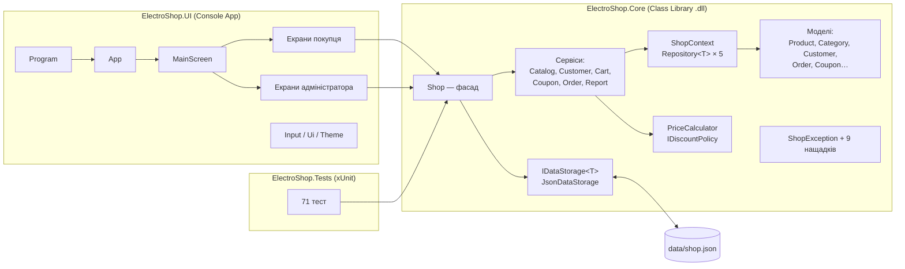

<div align="center">

**Київський авіаційний інститут**<br>
Кафедра інженерії програмного забезпечення

<br>

# Курсова робота
### з дисципліни «Об'єктно-орієнтоване програмування»

## ElectroShop — інтернет-магазин електроніки
**Варіант 2 · E-Commerce Store**

<br>

| |                                                                     |
|---|---------------------------------------------------------------------|
| **Виконав** | студент групи **Б-F2-25-1-ПІ**<br>**Бєлінський Олександр Павлович** |
| **Перевірив** | Колганова Олена Олегівна                                            |

<br>

Київ — 2026

</div>

---

## Зміст

1. [Опис завдання](#1-опис-завдання)
2. [Відповідність вимогам](#2-відповідність-вимогам)
3. [Структура рішення](#3-структура-рішення)
4. [Бізнес-частина (ElectroShop.Core.dll)](#4-бізнес-частина-electroshopcoredll)
5. [Інтерфейсна частина (ElectroShop.UI)](#5-інтерфейсна-частина-electroshopui)
6. [Збереження даних (серіалізація JSON)](#6-збереження-даних-серіалізація-json)
7. [Модульні тести](#7-модульні-тести)
8. [Запуск](#8-запуск)
9. [Важливі фрагменти коду](#9-важливі-фрагменти-коду)
10. [Приклади роботи](#10-приклади-роботи)

Додатково: [діаграма класів](docs/CLASS_DIAGRAM.md) · [гайд до захисту](docs/DEFENSE.md) · [промова](docs/SPEECH.md)

---

## 1. Опис завдання

Розробити консольний застосунок мовою C# для накопичення та обробки даних предметної області
**«Інтернет-магазин електроніки»**.

| Варіант 2 | |
|---|---|
| **Сутності** | `Product`, `Category`, `Order`, `Customer` |
| **Бізнес-логіка** | фільтрація товарів за ціною та брендом, застосування дисконтних купонів, розрахунок підсумкової вартості замовлення |
| **Власні винятки** | `OutOfStockException` — відсутність товару на складі; `InvalidDiscountException` — некоректний купон |

Окрім обов'язкового мінімуму реалізовано: кошик покупця, три типи купонів, програму лояльності,
життєвий цикл замовлення зі статусами, режим адміністратора з PIN-кодом, звіти з діаграмами,
події про закінчення товару на складі, відновлення після пошкодження файлу даних та 71 модульний тест.

## 2. Відповідність вимогам

| № | Вимога | Рівень | Реалізація |
|---|---|:-:|---|
| 1 | Консольний застосунок | — | `ElectroShop.UI` (Console App, .NET 9) |
| 2 | Система класів за варіантом | — | `Product`, `Category`, `Customer`, `Order` + `Cart`, `OrderItem`, ієрархія `Coupon` |
| 3 | Масиви / колекції / **узагальнені колекції** | ** | `List<T>`, `Dictionary<K,V>`, `HashSet<T>`, `IReadOnlyList<T>`, власний `Repository<T>` |
| 4 | Операції через інтерфейси та абстрактні класи (стандартні й власні) | — | власні: `IEntity`, `IRepository<T>`, `IDataStorage<T>`, `IDiscountPolicy`; стандартні: `IComparable<T>`, `IComparer<T>`, `IEnumerable<T>`; абстрактні: `EntityBase`, `Coupon`, `MenuScreen` |
| 5 | Збереження у файл при виході, завантаження при старті | * | `Shop.Save()` / `Shop.Load()`, автозбереження також при Ctrl+C |
| 6 | Контроль коректності введених даних | — | валідація в setter-ах моделей + повторний запит у `Input.Ask` |
| 7 | Обробка виняткових ситуацій, **власні класи винятків** | * | `ShopException` і 9 нащадків, централізований перехоплювач `Ui.Run` |
| 8 | **Бізнес-логіка в окремій DLL** | ** | `ElectroShop.Core.dll` підключена до `ElectroShop.UI` через ProjectReference |
| 9 | Хороший стиль: без public полів, кожен клас — в окремому файлі | — | лише приватні поля + властивості; один тип — один файл; константи оформлено як статичні властивості |
| — | **Робота з файлами через серіалізацію C#** | *** | `System.Text.Json`, поліморфна серіалізація купонів, `JsonDataStorage<T>` |

## 3. Структура рішення

```
ElectroShop.sln
├── src/
│   ├── ElectroShop.Core/            ← Class Library (.dll) — уся бізнес-логіка
│   │   ├── Abstractions/            IEntity, EntityBase, IRepository<T>, IDataStorage<T>, IDiscountPolicy
│   │   ├── Models/                  Product, Category, Customer, Cart, CartItem, Order, OrderItem, enum-и
│   │   │   └── Coupons/             Coupon (abstract) → PercentageCoupon, FixedAmountCoupon, CategoryCoupon
│   │   ├── Pricing/                 PriceCalculator, PricingContext, PriceBreakdown, LoyaltyProgram
│   │   ├── Comparers/               ProductPriceComparer, ProductBrandComparer, ProductStockComparer, …
│   │   ├── Repositories/            Repository<T> на основі List<T>
│   │   ├── Services/                Catalog-, Customer-, Cart-, Coupon-, Order-, ReportService, AdminAccess
│   │   ├── Persistence/             JsonDataStorage<T>, ShopSnapshot, ShopContext, DemoDataSeeder
│   │   ├── Exceptions/              ShopException + 9 власних винятків
│   │   └── Shop.cs                  фасад — єдина точка входу для UI
│   └── ElectroShop.UI/              ← Console App — лише введення/виведення
│       ├── Infrastructure/          MenuScreen, Input, Ui, Theme, NotificationCenter
│       ├── Screens/                 MainScreen, Customer/*, Admin/*
│       ├── Views/                   таблиці та картки товарів, замовлень, купонів
│       ├── App.cs                   запуск, завантаження, збереження
│       └── Program.cs
├── tests/ElectroShop.Tests/         ← xUnit, 71 тест
└── docs/                            діаграма класів, гайд до захисту
```



Повна діаграма класів — у [docs/CLASS_DIAGRAM.md](docs/CLASS_DIAGRAM.md).

## 4. Бізнес-частина (ElectroShop.Core.dll)

### 4.1. Моделі

Усі сутності успадковують абстрактний `EntityBase` (ідентифікатор `Guid Id` та абстрактну властивість `DisplayName`).
Поля моделей приватні, доступ — через властивості з перевіркою у setter-і. Тому об'єкт **неможливо створити
в некоректному стані** ні з UI, ні під час завантаження з файлу.

| Клас | Призначення | Ключові правила |
|---|---|---|
| `Product` | товар | артикул формату `ABC-123`, ціна 0,01–1 000 000 ₴, залишок ≥ 0, гарантія 0–60 міс., характеристики у `Dictionary` |
| `Category` | категорія | назва 2–40 символів, унікальна; не можна видалити, поки в ній є товари |
| `Customer` | покупець | ПІБ лише з літер, email за регулярним виразом, телефон нормалізується до `+380XXXXXXXXX` |
| `Cart` / `CartItem` | кошик | ≤ 20 шт. одного товару, кількість не більша за залишок на складі |
| `Order` / `OrderItem` | замовлення | знімок ціни на момент покупки, історія статусів, контроль переходів |
| `Coupon` та нащадки | купони | термін дії, мінімальна сума, ліміт використань, деактивація |

### 4.2. Ціноутворення

`PriceCalculator` формує `PriceBreakdown`: вартість товарів → знижка за купоном → знижка лояльності → доставка → до сплати.

* **Купони** (поліморфізм через абстрактний метод `CalculateRawDiscount`):
  `PercentageCoupon` (1–50 % на все), `FixedAmountCoupon` (фіксована сума), `CategoryCoupon` (1–70 % лише на товари однієї категорії).
* **Програма лояльності**: Срібний від 20 000 ₴ покупок — 3 %, Золотий від 50 000 ₴ — 5 %, Платиновий від 100 000 ₴ — 7 %.
* **Обмеження**: сумарна знижка не перевищує 50 % вартості товарів.
* **Доставка**: самовивіз — 0 ₴, відділення пошти — 80 ₴, кур'єр — 150 ₴; безкоштовно від 5 000 ₴.

Купон і знижка лояльності реалізують спільний інтерфейс `IDiscountPolicy`, тож калькулятор працює з ними однаково.

### 4.3. Життєвий цикл замовлення

```
Нове ──► Оплачено ──► Відправлено ──► Доставлено
  │          │
  └──────────┴──► Скасовано   (товар повертається на склад, сума покупок клієнта зменшується)
```

Недозволений перехід (наприклад, «Доставлено → Скасовано») кидає `InvalidOrderStateException`.

### 4.4. Сервіси

| Сервіс | Відповідальність |
|---|---|
| `CatalogService` | категорії та товари, пошук і фільтрація (`ProductFilter`), сортування (`IComparer<Product>`) |
| `CustomerService` | реєстрація, вхід за email, редагування профілю |
| `CartService` | додавання / зміна / видалення товарів кошика з перевіркою залишку |
| `CouponService` | створення, активація, перевірка та пошук купонів |
| `OrderService` | попередній розрахунок, оформлення, зміна статусу, скасування; подія `LowStock` |
| `ReportService` | виручка, середній чек, топ товарів, виручка за категоріями (LINQ) |
| `AdminAccess` | вхід адміністратора за PIN (зберігається лише SHA-256 хеш), блокування після 3 спроб |

Фасад `Shop` створює всі сервіси й надає інтерфейсу одну точку входу.

### 4.5. Власні винятки

| Виняток | Коли виникає |
|---|---|
| `ShopException` | базовий клас для всіх помилок бізнес-логіки |
| `OutOfStockException` | запитано більше, ніж є на складі (зберігає `Requested`, `Available`) |
| `InvalidDiscountException` | купон не існує, прострочений, ще не діє, вичерпаний, деактивований, мала сума замовлення, немає товарів потрібної категорії, некоректний відсоток |
| `EntityNotFoundException` | клієнта / замовлення / товар не знайдено |
| `DuplicateEntityException` | повторний email, артикул, назва категорії чи код купона |
| `EntityInUseException` | видалення непорожньої категорії або вже використаного купона |
| `EmptyCartException` | оформлення замовлення з порожнім кошиком |
| `InvalidOrderStateException` | недозволена зміна статусу замовлення |
| `AccessDeniedException` | невірний PIN адміністратора або блокування |
| `DataStorageException` | файл даних пошкоджено чи недоступний (обгортає `JsonException`, `IOException`) |

## 5. Інтерфейсна частина (ElectroShop.UI)

Інтерфейс побудовано на бібліотеці **Spectre.Console**: кольорові таблиці, панелі, меню зі стрілками,
пошук у списках, гістограми та діаграми.

**Режим покупця**: каталог з пошуком і фільтрами (категорія, бренди, діапазон цін, наявність, сортування),
картка товару з характеристиками, кошик, покрокове оформлення замовлення з вибором доставки та купона,
історія замовлень зі скасуванням, профіль з прогресом програми лояльності.

**Режим адміністратора** (PIN `1234`): дашборд, керування товарами та складом, категоріями, купонами
(три типи), статусами замовлень, перегляд клієнтів, звіти з діаграмами, сповіщення про закінчення товарів.

**Перевірка введення.** Метод `Input.Ask<T>(label, parse)` повторює запит, поки введене значення не пройде
перевірку. Функцією перевірки зазвичай є **setter моделі з бізнес-бібліотеки**, тож правила валідації
описані в одному місці:

```csharp
var name = Input.Ask("ПІБ", s => probe.FullName = s);   // помилка setter-а → червоне повідомлення → повторний запит
```

**Обробка помилок.** Усі дії меню виконуються через `Ui.Run(action)`, який перехоплює `ShopException`,
`ArgumentException`, `FormatException` і показує панель з повідомленням та типом винятку. Програма не
завершується аварійно через некоректні дані.

Усі екрани успадковують абстрактний `MenuScreen` (шаблонний метод): базовий клас малює заголовок
з «хлібними крихтами», виводить меню, обробляє «Назад»/Esc і помилки, а нащадок визначає лише вміст і пункти.

## 6. Збереження даних (серіалізація JSON)

* Усі дані магазину об'єднуються в `ShopSnapshot` і серіалізуються `System.Text.Json` у `data/shop.json`.
* Під час запуску дані завантажуються; якщо файлу немає — магазин заповнюється демо-даними.
* Під час виходу (і при Ctrl+C) дані зберігаються автоматично; адміністратор може зберегти вручну.
* **Поліморфна серіалізація**: абстрактний `Coupon` позначено `[JsonPolymorphic]`/`[JsonDerivedType]`,
  тож у файлі зберігається дискримінатор `"$type": "percent" | "fixed" | "category"` і після завантаження
  відновлюються саме потрібні класи-нащадки.
* Приватні колекції (`Cart.Items`, `Order.Items`, `Product.Specifications`) серіалізуються через `[JsonInclude]`
  на приватних властивостях — інкапсуляція не порушується.
* **Безпечний запис**: спочатку у тимчасовий файл, потім атомарна заміна — збій під час запису не зіпсує дані.
* **Пошкоджений файл**: некоректний JSON або значення, що не проходять валідацію (наприклад, від'ємна ціна),
  перетворюються на `DataStorageException`; програма пропонує створити резервну копію та продовжити.

## 7. Модульні тести

`tests/ElectroShop.Tests` — 71 тест xUnit:

| Файл | Що перевіряється |
|---|---|
| `ModelValidationTests` | валідація артикулу, ціни, залишку, email, телефону, ПІБ |
| `CouponTests` | розрахунок трьох типів купонів і всі причини `InvalidDiscountException` |
| `PricingTests` | рівні лояльності, доставка, комбінування знижок, обмеження 50 % |
| `OrderServiceTests` | кошик, `OutOfStockException`, оформлення, подія `LowStock`, скасування, статуси |
| `CatalogAndCustomerTests` | фільтри, компаратори, дублікати, видалення, PIN адміністратора |
| `PersistenceTests` | збереження → завантаження, типи купонів, кошик, пошкоджений файл, резервна копія |

## 8. Запуск

Потрібен [.NET SDK 9](https://dotnet.microsoft.com/download).

```bash
dotnet run --project src/ElectroShop.UI          # запуск застосунку
dotnet run --project src/ElectroShop.UI -- my.json   # інший файл даних
dotnet test                                      # модульні тести
```

Для гарного відображення розгорніть термінал щонайменше на 120 колонок (Windows Terminal, iTerm2, термінал
VS Code / Rider).

| Демо-дані | |
|---|---|
| Покупці | `olena@gmail.com` (Платиновий рівень), `andrii.shevchuk@ukr.net` (має товар у кошику), `maria.bondar@gmail.com` |
| Адміністратор | PIN `1234` |
| Купони | `WELCOME10` −10 % · `MINUS1000` −1000 ₴ від 15 000 ₴ · `AUDIO15` −15 % на аудіо · `ONCE300` одноразовий · `SUMMER25` прострочений · `BLACKFRIDAY` ще не діє |

Щоб почати з чистих демо-даних, видаліть теку `data/`.

## 9. Важливі фрагменти коду

**Інкапсуляція і валідація у властивості** — `Models/Product.cs`

```csharp
public decimal Price
{
    get => _price;
    set => _price = Guard.Range(decimal.Round(value, 2), "Ціна", 0.01m, MaxPrice);
}

public void ReserveStock(int quantity)
{
    Guard.Range(quantity, "Кількість", 1, int.MaxValue);
    EnsureInStock(quantity);          // кидає OutOfStockException
    StockQuantity -= quantity;
}
```

**Шаблонний метод і поліморфізм купонів** — `Models/Coupons/Coupon.cs`

```csharp
public void EnsureApplicable(PricingContext context, DateTime now)
{
    if (!IsActive)
        throw new InvalidDiscountException("купон деактивовано.", Code);
    if (IsExpired(now))
        throw new InvalidDiscountException($"термін дії завершився {ValidUntil:dd.MM.yyyy}.", Code);
    // ... інші спільні перевірки
    ValidateSpecific(context);        // віртуальний — CategoryCoupon перевіряє наявність категорії
}

public decimal CalculateDiscount(PricingContext context) =>
    Math.Min(decimal.Round(CalculateRawDiscount(context), 2), context.Subtotal);

protected abstract decimal CalculateRawDiscount(PricingContext context);
```

**Узагальнений репозиторій** — `Repositories/Repository.cs`

```csharp
public class Repository<T> : IRepository<T> where T : class, IEntity
{
    private readonly List<T> _items = new();

    public T this[Guid id] => GetById(id);

    public T GetById(Guid id) => FindById(id) ?? throw new EntityNotFoundException(_entityName, id);

    public IReadOnlyList<T> Find(Predicate<T> match) => _items.FindAll(match);
}
```

**Атомарне оформлення замовлення** — `Services/OrderService.cs`

```csharp
public Order PlaceOrder(Customer customer, DeliveryMethod delivery, string? couponCode = null)
{
    // Усі перевірки виконуються до будь-яких змін
    var items = BuildItems(customer);                 // EmptyCartException, OutOfStockException
    var coupon = ResolveCoupon(couponCode, items);    // InvalidDiscountException
    var pricing = _calculator.Calculate(items, delivery, coupon, customer.LoyaltyLevel);

    foreach (var item in items)
    {
        var product = _context.Products.GetById(item.ProductId);
        product.ReserveStock(item.Quantity);
        if (!product.IsAvailable || product.IsLowStock)
            LowStock?.Invoke(this, new LowStockEventArgs(product));
    }
    // ...
}
```

**Поліморфна серіалізація** — `Models/Coupons/Coupon.cs`

```csharp
[JsonPolymorphic(TypeDiscriminatorPropertyName = "$type")]
[JsonDerivedType(typeof(PercentageCoupon), "percent")]
[JsonDerivedType(typeof(FixedAmountCoupon), "fixed")]
[JsonDerivedType(typeof(CategoryCoupon), "category")]
public abstract partial class Coupon : EntityBase, IDiscountPolicy
```

## 10. Приклади роботи

**Каталог із фільтрами**

```
── ⚡ ElectroShop › Головне меню › Олена Коваленко › Каталог ──────────────────────────────────────
╭────┬───────────────┬──────────────────────────────┬─────────────────┬────────────────┬──────────╮
│  # │ Артикул       │ Товар                        │ Категорія       │           Ціна │ Наявність│
├────┼───────────────┼──────────────────────────────┼─────────────────┼────────────────┼──────────┤
│  1 │ PHN-1005      │ Samsung Galaxy A56           │ Смартфони       │    17 499,00 ₴ │    немає │
│  2 │ PHN-1002      │ Samsung Galaxy S25 256GB     │ Смартфони       │    38 499,00 ₴ │    8 шт. │
│  3 │ TAB-3002      │ Samsung Galaxy Tab S10 FE    │ Планшети        │    19 999,00 ₴ │   10 шт. │
│  4 │ WTC-5002      │ Samsung Galaxy Watch 7       │ Смарт-годинники │    10 999,00 ₴ │    8 шт. │
╰────┴───────────────┴──────────────────────────────┴─────────────────┴────────────────┴──────────╯
Знайдено: 4 · Сортування: За назвою (А–Я)
Фільтри: Samsung · 10 000 ₴ – 40 000 ₴
```

**Спрацювання `OutOfStockException`**

```
› Кількість: 19
╭─✖ Операцію відхилено──────────────────────────────────────────────────────────────╮
│ Недостатньо товару «Samsung Galaxy S25 256GB» на складі: запитано 19, доступно 8. │
│ OutOfStockException                                                               │
╰───────────────────────────────────────────────────────────────────────────────────╯
```

**Оформлення замовлення: прострочений купон → дійсний купон**

```
› Код купона: SUMMER25
  ✖ Купон SUMMER25: термін дії завершився 20.08.2026.
› Код купона: AUDIO15
── 4. Підсумок ───────────────────────────────────
╭─Розрахунок вартості───────────────────────╮
│ Вартість товарів             37 997,00 ₴  │
│ Знижка за купоном            −1 499,85 ₴  │
│ Знижка постійного клієнта    −1 139,91 ₴  │
│ Доставка                     безкоштовно  │
│ До сплати                    35 357,24 ₴  │
╰───────────────────────────────────────────╯
? Підтвердити замовлення на 35 357,24 ₴? [Т/н] так
╭───────────────────────────────────────────────────╮
│ ✔ Замовлення #00008 оформлено! Сума: 35 357,24 ₴. │
│ Вітаємо! Ваш новий рівень лояльності: ★ Золотий   │
╰───────────────────────────────────────────────────╯
```

**Валідація під час реєстрації**

```
› ПІБ: R2D2
  ✖ ПІБ має некоректний формат. Лише літери, пробіл, дефіс та апостроф.
› Email: olena@gmail.com
  ✖ Цей email вже зареєстровано — скористайтесь входом.
› Телефон (+380XXXXXXXXX): 12345
  ✖ Телефон має некоректний формат. Формат: +380XXXXXXXXX.
› Телефон (+380XXXXXXXXX): 093 111 22 33
```

**Пошкоджений файл даних**

```
╭─✖ Помилка файлу даних────────────────────────────────────────────────────╮
│ Файл містить некоректні дані: Ціна має бути в межах від 0,01 до 1000000. │
│ DataStorageException                                                     │
╰──────────────────────────────────────────────────────────────────────────╯
Що робимо з пошкодженим файлом?
> Створити резервну копію та заповнити демо-даними
  Створити резервну копію та почати з порожнього магазину
  Вийти, нічого не змінюючи
```
