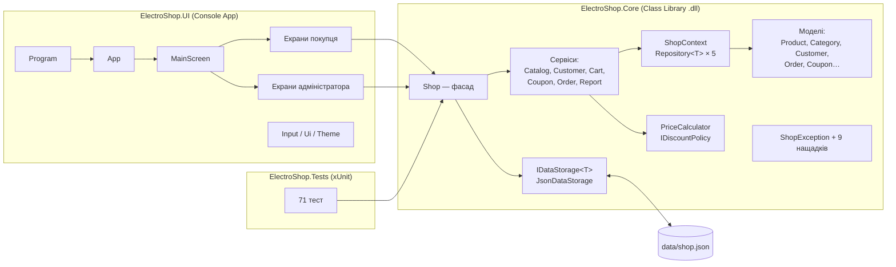
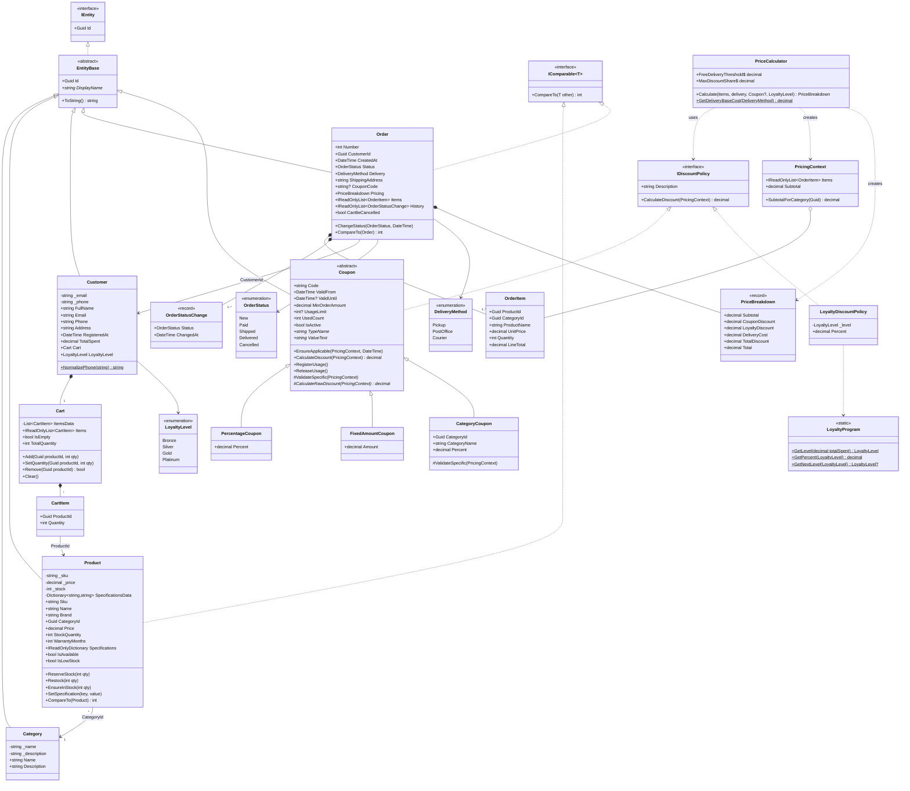
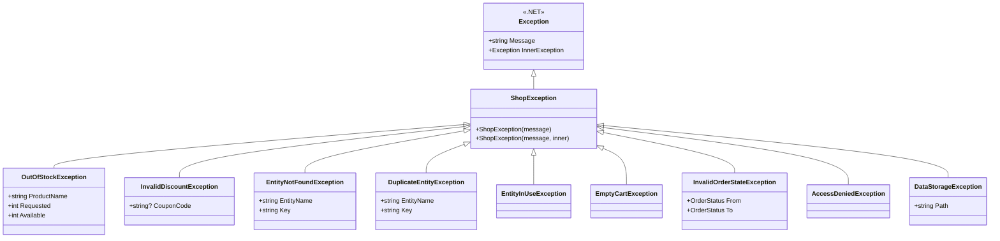
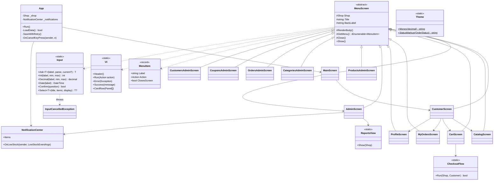

# Діаграма класів ElectroShop

Діаграми записано в [Mermaid](https://mermaid.js.org/) — вони відображаються прямо на GitHub і в VS Code (розширення *Markdown Preview Mermaid Support*). Для друку чи вставки в презентацію відкрийте [`class-diagram.html`](class-diagram.html) у браузері та збережіть сторінку як PDF (Ctrl+P). Вихідні файли діаграм — у теці [`diagrams/`](diagrams/).

## 0. Архітектура рішення

Три проєкти: бізнес-логіка винесена в окрему бібліотеку `ElectroShop.Core.dll`, консольний інтерфейс лише звертається до фасаду `Shop`.

## 1. Модель предметної області та ціноутворення

Сутності магазину, ієрархія купонів (поліморфний розрахунок знижки) і калькулятор ціни.

## 2. Сервіси, репозиторії, збереження даних

```mermaid
classDiagram
    direction TB

    class Shop {
        <<facade>>
        -IDataStorage~ShopSnapshot~ _storage
        -ShopContext _context
        -TimeProvider _time
        +CatalogService Catalog
        +CustomerService Customers
        +CartService Carts
        +CouponService Coupons
        +OrderService Orders
        +ReportService Reports
        +AdminAccess Admin
        +Load()
        +Save()
        +SeedDemoData()
        +BackupStorage() string
    }

    class IRepository~T~ {
        <<interface>>
        +int Count
        +this[Guid id] T
        +Add(T item)
        +Remove(Guid id) bool
        +GetById(Guid id) T
        +FindById(Guid id) T?
        +GetAll() IReadOnlyList~T~
        +Find(Predicate~T~) IReadOnlyList~T~
        +Exists(Predicate~T~) bool
    }
    class Repository~T~ {
        -List~T~ _items
        -string _entityName
    }
    class IEnumerable~T~ {
        <<interface>>
    }
    IEnumerable~T~ <|-- IRepository~T~
    IRepository~T~ <|.. Repository~T~

    class ShopContext {
        +IRepository~Category~ Categories
        +IRepository~Product~ Products
        +IRepository~Customer~ Customers
        +IRepository~Order~ Orders
        +IRepository~Coupon~ Coupons
        +ToSnapshot(DateTime) ShopSnapshot
        +LoadFrom(ShopSnapshot)
    }
    ShopContext *-- "5" Repository~T~

    class IDataStorage~T~ {
        <<interface>>
        +string Location
        +bool Exists
        +Save(T data)
        +Load() T
        +Backup() string
    }
    class JsonDataStorage~T~ {
        -JsonSerializerOptions Options$
        -string _path
    }
    class ShopSnapshot {
        +int Version
        +DateTime SavedAt
        +List~Category~ Categories
        +List~Product~ Products
        +List~Customer~ Customers
        +List~Order~ Orders
        +List~Coupon~ Coupons
    }
    IDataStorage~T~ <|.. JsonDataStorage~T~
    JsonDataStorage~T~ ..> ShopSnapshot : serializes
    ShopContext ..> ShopSnapshot

    class CatalogService {
        +Search(ProductFilter) IReadOnlyList~Product~
        +AddCategory(name, description) Category
        +RemoveCategory(Guid)
        +AddProduct(Product)
        +RemoveProduct(Guid)
        +Restock(Guid, int)
        +GetBrands() IReadOnlyList~string~
        +GetLowStock() IReadOnlyList~Product~
    }
    class CustomerService {
        +Register(name, email, phone, address) Customer
        +Login(email) Customer
        +UpdateProfile(Customer, name, phone, address)
        +GetAll() IReadOnlyList~Customer~
    }
    class CartService {
        +GetLines(Customer) IReadOnlyList~CartLine~
        +Add(Customer, Guid, int)
        +SetQuantity(Customer, Guid, int)
        +Remove(Customer, Guid) bool
    }
    class CouponService {
        +Add(Coupon)
        +Resolve(code, PricingContext) Coupon
        +GetAvailable() IReadOnlyList~Coupon~
        +SetActive(Coupon, bool)
    }
    class OrderService {
        +event LowStock
        +Preview(Customer, DeliveryMethod, code?) PriceBreakdown
        +PlaceOrder(Customer, DeliveryMethod, code?) Order
        +ChangeStatus(Order, OrderStatus)
        +Cancel(Order)
        +GetAll(OrderStatus?) IReadOnlyList~Order~
    }
    class ReportService {
        +GetSummary() SalesSummary
        +GetTopProducts(int) IReadOnlyList~ProductSales~
        +GetRevenueByCategory() IReadOnlyList~CategoryRevenue~
        +GetOrdersByStatus() IReadOnlyDictionary
    }
    class AdminAccess {
        -int _failedAttempts
        +bool IsLocked
        +int AttemptsLeft
        +Authenticate(string pin)
    }
    class ProductFilter {
        -HashSet~string~ _brands
        +string? SearchText
        +Guid? CategoryId
        +bool InStockOnly
        +ProductSortOption SortBy
        +SetPriceRange(min, max)
        +SetBrands(IEnumerable~string~)
        +Matches(Product) bool
    }
    class LowStockEventArgs {
        +Product Product
    }
    class CartLine {
        <<record>>
        +Product Product
        +int Quantity
        +decimal LineTotal
    }

    Shop o-- IDataStorage~T~
    Shop *-- ShopContext
    Shop *-- CatalogService
    Shop *-- CustomerService
    Shop *-- CartService
    Shop *-- CouponService
    Shop *-- OrderService
    Shop *-- ReportService
    Shop *-- AdminAccess
    OrderService --> CartService
    OrderService --> CouponService
    OrderService --> PriceCalculator
    OrderService ..> LowStockEventArgs : raises
    CatalogService ..> ProductFilter
    CartService ..> CartLine

    class IComparer~Product~ {
        <<interface>>
        +Compare(x, y) int
    }
    class ProductPriceComparer {
        -bool _descending
    }
    class ProductBrandComparer
    class ProductStockComparer
    class CustomerSpendingComparer
    class ProductComparers {
        <<static>>
        +For(ProductSortOption)$ IComparer~Product~
    }
    IComparer~Product~ <|.. ProductPriceComparer
    IComparer~Product~ <|.. ProductBrandComparer
    IComparer~Product~ <|.. ProductStockComparer
    ProductComparers ..> IComparer~Product~ : creates
    CatalogService ..> ProductComparers
    CustomerService ..> CustomerSpendingComparer
```

Фасад `Shop`, узагальнений репозиторій `Repository<T>`, JSON-сховище та компаратори для сортування.

## 3. Власні винятки

Усі помилки бізнес-логіки успадковані від `ShopException`, тож UI може обробити їх одним `catch`.

## 4. Консольний інтерфейс

Екрани успадковують абстрактний `MenuScreen` (шаблонний метод), введення централізовано в `Input`.

## Умовні позначення

| Позначення | Значення |
|---|---|
| `<\|--` суцільна лінія з трикутником | успадкування (наслідування класу) |
| `<\|..` пунктир з трикутником | реалізація інтерфейсу |
| `*--` ромб зафарбований | композиція (частина не існує без цілого) |
| `o--` ромб порожній | агрегація |
| `-->` | асоціація (посилання) |
| `..>` | залежність (використовує / створює) |
| `+` / `-` / `#` | public / private / protected |
| `*` після члена | абстрактний член |
| `$` після члена | статичний член |
| `~T~` | узагальнений параметр (generic) |
